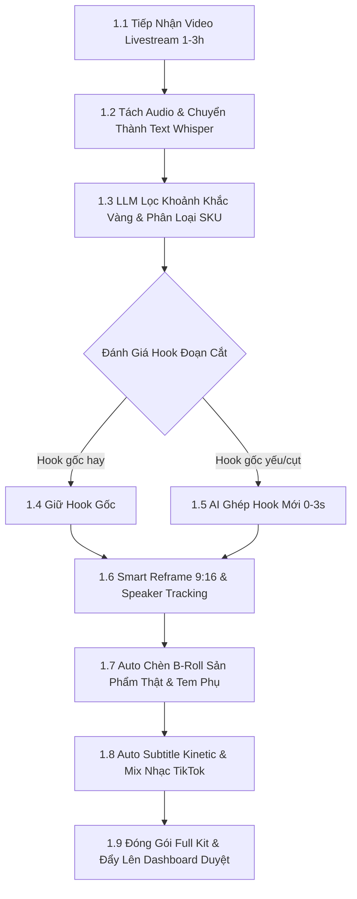
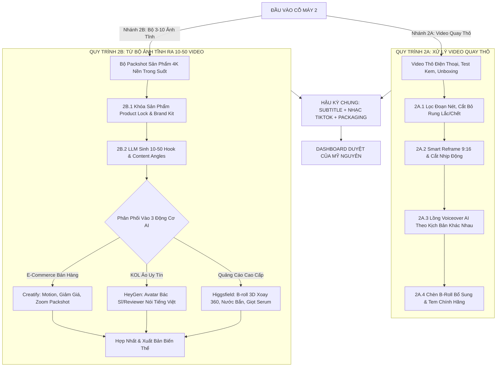
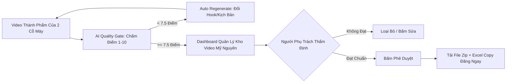

# QUY TRÌNH CHUẨN: HỆ THỐNG AI CONTENT FACTORY TIKTOK (MỸ NGUYÊN TSC)
> **Dự án**: Xây dựng hệ thống sản xuất video ngắn TikTok tự động hóa (10–50 video/ngày)  
> **Khách hàng**: CÔNG TY TNHH TM & DV MỸ NGUYÊN (MỸ NGUYÊN TSC)  
> **Đặc thù ngành**: Nhập khẩu & phân phối sỉ/lẻ Mỹ phẩm Hàn Quốc chính hãng (Farmstay, Sehwa,...)  
> **Bộ não điều phối**: **n8n Workflow Engine** kết hợp đa công cụ AI (Creatify + HeyGen + Higgsfield + Whisper + LLM + FFmpeg)

---

## TỔNG QUAN: 2 CỖ MÁY SẢN XUẤT CỐT LÕI THEO REQUIREMENT

Requirement của Mỹ Nguyên phân chia bài toán sản xuất thành **2 CỖ MÁY (PIPELINES) ĐẦU VÀO ĐỘC LẬP**:

```
                                    ┌────────────────────────────────────────────────────────┐
                                    │               BỘ NÃO ĐIỀU PHỐI (n8n ENGINE)            │
                                    └───────────────────────────┬────────────────────────────┘
                                                                │
                 ┌──────────────────────────────────────────────┴──────────────────────────────────────────────┐
                 ▼                                                                                             ▼
┌─────────────────────────────────────────────────┐                                           ┌─────────────────────────────────────────────────┐
│                   CỖ MÁY 1                      │                                           │                   CỖ MÁY 2                      │
│     TÁI CHẾ TỪ LIVESTREAM THỰC TẾ (1-3 GIỜ)     │                                           │         TỪ VIDEO QUAY THÔ HOẶC ẢNH TĨNH         │
│             (Livestream-to-Shorts)              │                                           │        (Raw Footage & Static Images)            │
├─────────────────────────────────────────────────┤                                           ├─────────────────────────────────────────────────┤
│ • Đầu vào: 1 file Livestream dài 1-3 tiếng      │                                           │ • Đầu vào A: Video thô điện thoại, unboxing     │
│ • Nhận diện sản phẩm, lọc khoảnh khắc vàng      │                                           │ • Đầu vào B: Bộ 3-10 ảnh tĩnh sản phẩm          │
│ • Cắt bỏ khoảng lặng, loại bỏ nói vấp           │                                           │ • Tạo 10-50 biến thể Hook & kịch bản khác nhau │
│ • Reframe 9:16 + Auto Subtitle + B-roll thật    │                                           │ • Phân luồng: Creatify / HeyGen / Higgsfield    │
│ • Sản lượng: 20–50 video ngắn/buổi live         │                                           │ • Sản lượng: 10–50 video hoàn chỉnh/ngày        │
└─────────────────────────────────────────────────┘                                           └─────────────────────────────────────────────────┘
                                                                │
                                                                ▼
                                    ┌────────────────────────────────────────────────────────┐
                                    │    HẬU KỲ CHUNG, AI CHẤM ĐIỂM & REVIEW DASHBOARD      │
                                    │       (Đóng gói Metadata, Duyệt trước khi đăng)        │
                                    └────────────────────────────────────────────────────────┘
```

---

# CỖ MÁY 1: QUY TRÌNH TÁI CHẾ TỪ LIVESTREAM THẬT (LIVESTREAM-TO-SHORTS)
> **Mục tiêu**: Từ 1 buổi livestream bán hàng kéo dài 1–3 tiếng của chủ shop/streamer Mỹ Nguyên, tự động bóc tách thành **20–50 video ngắn TikTok hoàn chỉnh**, không còn đoạn thừa, có phụ đề nhảy chữ và giữ đúng sản phẩm thực tế.



### Chi tiết các bước thực hiện Cỗ máy 1:

| Bước | Tên bước | Đầu vào (Input) | Nội dung công việc (What to do) | Đầu ra (Output) | Thực hiện & Công cụ | Điểm lưu ý cốt lõi |
| :---: | :--- | :--- | :--- | :--- | :--- | :--- |
| **1.1** | **Tiếp nhận & Chuẩn hóa Livestream** | • File video livestream (1080p, định dạng MP4/MKV, thời lượng 1–3h, dung lượng 2–10GB) tải từ TikTok/FB Live. | • n8n tách luồng xử lý:<br>1. Trích xuất file âm thanh WAV chất lượng cao (16kHz) để AI phân tích lời nói.<br>2. Lưu trữ video gốc vào Cloud Storage với ID phiên live để cắt ghép. | • File âm thanh `stream_audio.wav`<br>• File video gốc đã gán ID phiên live trên Cloud Storage. | **Automation**<br>*(n8n Webhook, FFmpeg Server)* | Máy chủ cần băng thông tốt và dung lượng tạm thời đủ lớn để xử lý video nặng. |
| **1.2** | **Transcription & Mốc thời gian (Timestamp)** | • File âm thanh `stream_audio.wav`. | • Chuyển toàn bộ tiếng nói trong buổi live thành văn bản tiếng Việt.<br>• Gắn timestamp chính xác đến từng từ (Word-level timestamps).<br>• Nhận diện phân đoạn người nói (Diarization). | • File `transcript.json` chứa toàn bộ lời thoại kèm mốc thời gian chi tiết (start, end, text, speaker). | **AI**<br>*(Whisper Large-v3 / Groq Whisper API)* | Whisper v3 nhận diện tiếng Việt cực chuẩn, xử lý tốt cả từ ngữ địa phương và tiếng lóng bán hàng. |
| **1.3** | **LLM Lọc "Khoảnh Khắc Vàng" & Gắn SKU** | • File `transcript.json`<br>• Danh mục SKU sản phẩm của Mỹ Nguyên. | • LLM phân tích ngữ nghĩa, tìm các đoạn đắt giá 20s–60s:<br>  * Đoạn tung deal / giảm giá sốc.<br>  * Đoạn giải đáp thắc mắc da mụn.<br>  * Đoạn test thoa serum lên tay.<br>• Nhận diện đúng tên SKU đang nói.<br>• Loại bỏ đoạn im lặng, nói vấp, mạng lag. | • Danh sách 20–50 phân đoạn tiềm năng dưới dạng JSON: `[{segment_id, sku, start_time, end_time, raw_text, topic}]`. | **AI + Automation**<br>*(Claude 3.5 Sonnet / GPT-4o điều phối bởi n8n)* | Master Prompt cần có whitelist tên SKU để AI không bị nhầm lẫn giữa các sản phẩm tương tự. |
| **1.4** | **Đánh giá & Ghép Hook 0–3s Mới (Hook Injection)** | • Dữ liệu từng phân đoạn (`raw_text`, `start_time`). | • Đánh giá câu mở đầu đoạn live:<br>  * *Nếu câu mở đầu đủ giật tít*: Giữ nguyên.<br>  * *Nếu câu mở đầu cụt/yếu*: AI tự tạo Hook mới (Dòng Text to giật tít + Sound Effect "Ting"/"Whoosh", hoặc sinh voiceover AI 3 giây đầu để mớm lời). | • Kịch bản Hook bổ sung<br>• File audio voiceover 3s (nếu có)<br>• Chỉ thị layer Text Hook 0–3s đầu. | **AI + Automation**<br>*(LLM, ElevenLabs/Vbee, FFmpeg)* | **Cực kỳ quan trọng**: Quyết định 80% tỷ lệ giữ chân người xem ở 3 giây đầu tiên trên TikTok. |
| **1.5** | **Smart Reframe 9:16 & Speaker Tracking** | • Video gốc<br>• Mốc thời gian (`start_time`, `end_time`) của từng đoạn. | • Tự động crop từ video ngang/rộng thành video dọc 9:16 Full HD (1080x1920).<br>• Tự động tracking theo khuôn mặt streamer và sản phẩm trên tay vào trung tâm khung hình. | • 20–50 file video clip cắt thô chuẩn dọc 9:16 (`clip_raw_001.mp4` ... `clip_raw_050.mp4`). | **AI + Automation**<br>*(FFmpeg Script / Auto Reframe API / CapCut API)* | Không crop quá sát làm méo hoặc cắt mất sản phẩm trên tay người live. |
| **1.6** | **Chèn B-Roll Sản Phẩm Thật & Tem Phụ (Product Lock)** | • Clip thô 9:16<br>• Ảnh packshot 4K & tem phụ của SKU tương ứng trong thư viện. | • Khi streamer nhắc đến sản phẩm, hệ thống tự động overlay:<br>  1. Khung B-roll ảnh sản phẩm sắc nét ở góc màn hình.<br>  2. Nhãn tem phụ tiếng Việt + cam kết chính hãng Mỹ Nguyên TSC.<br>  3. Mũi tên trỏ vào giỏ hàng góc trái. | • Video clip 9:16 đã tích hợp B-roll sản phẩm sắc nét và tem chính hãng (`clip_broll_001.mp4`). | **Automation**<br>*(n8n + FFmpeg Overlay Layer)* | Đảm bảo người xem luôn thấy rõ bao bì sắc nét, không bị phụ thuộc vào camera live bị mờ. |
| **1.7** | **Auto Subtitle Kinetic & Mix Nhạc Nền** | • Clip có B-roll<br>• Word-level timestamp của đoạn<br>• Thư viện nhạc thương mại TikTok. | • Tạo phụ đề nhảy chữ theo lời nói (Karaoke style), highlight vàng từ khóa quan trọng (*căng bóng, giảm giá, chính hãng*).<br>• Chèn nhạc nền TikTok và tự động hạ âm lượng nhạc (Auto-ducking) khi streamer đang nói. | • File video thành phẩm hoàn chỉnh có âm thanh cân bằng và phụ đề nổi (`FARMSTAY_LS_001.mp4`). | **AI + Automation**<br>*(Whisper Subtitle Engine + FFmpeg Audio Filter)* | Font chữ phụ đề phải to, đậm, đặt ở vùng an toàn (Safe Zone) tránh bị nút Like/Share/Caption che khuất. |
| **1.8** | **Đóng gói Metadata & Đẩy Lên Dashboard** | • File video hoàn chỉnh<br>• Nội dung đoạn nói<br>• Thông tin SKU sản phẩm. | • AI sinh bộ thông tin đi kèm: Hook tóm tắt, Caption chuẩn SEO TikTok, 5–7 Hashtags, CTA giỏ hàng.<br>• n8n đẩy video và metadata lên Dashboard quản lý chờ nhân sự duyệt. | • Gói Content Kit hoàn chỉnh hiển thị trên Dashboard (Record gồm Video + Text + Trạng thái *Chờ duyệt*). | **AI + Automation**<br>*(GPT-4o/Claude 3.5, n8n, Airtable/Web Dashboard)* | 1 buổi live 2 tiếng phải tự động xuất xưởng đều đặn 20–40 clip dạng này sẵn sàng trên hàng đợi. |

---

# CỖ MÁY 2: TỪ VIDEO QUAY THÔ HOẶC BỘ ẢNH TĨNH → TẠO 10–50 VIDEO HOÀN CHỈNH
> **Mục tiêu**: Chỉ từ tư liệu quay thô bằng điện thoại HOẶC bộ 3–10 ảnh tĩnh sản phẩm của Mỹ Nguyên, tự động sinh ra **10–50 video TikTok đa dạng biến thể**, không video nào giống video nào, phục vụ phủ kênh vệ tinh và A/B testing.

Cỗ máy này chia làm **2 NHÁNH ĐẦU VÀO**:
* **Nhánh 2A**: Từ **Video quay thô** (Raw Footages: video bóc hộp thô, video test chất serum lên tay, video góc quay sản phẩm không lời).
* **Nhánh 2B**: Từ **Bộ 3–10 Ảnh tĩnh** (Static Packshots: ảnh chụp chai lọ trên nền trắng, ảnh bối cảnh bàn trang điểm).



---

### Chi tiết Nhánh 2A: Từ Video Quay Thô (Raw Footage-to-Videos)

| Bước | Tên bước | Đầu vào (Input) | Nội dung công việc (What to do) | Đầu ra (Output) | Thực hiện & Công cụ | Điểm lưu ý cốt lõi |
| :---: | :--- | :--- | :--- | :--- | :--- | :--- |
| **2A.1** | **Lọc đoạn chất lượng & Cắt bỏ lỗi** | • Video quay thô từ điện thoại (unboxing, test thoa kem, cận cảnh sản phẩm không lời). | • Tự động phân tích từng cảnh quay (Scene detection).<br>• Phát hiện và cắt bỏ các đoạn bị out-focus, đoạn rung lắc mạnh, đoạn thừa không có hoạt động. | • Các đoạn video thô đạt chuẩn sắc nét, rõ hành động (thoa kem, nhỏ giọt, mở nắp). | **AI Vision + Automation**<br>*(OpenCV, FFmpeg Scene Detect, n8n)* | Giữ lại các chuyển động tay dứt khoát, ánh sáng rõ ràng trên bề mặt sản phẩm. |
| **2A.2** | **Reframe 9:16 & Cắt nhịp đa dạng** | • Các đoạn video thô đã lọc. | • Chuẩn hóa kích thước sang dọc 9:16 Full HD (1080x1920).<br>• Từ 1 nguồn video thô dài 3–5 phút, tự động tạo **5–10 cách dựng có nhịp điệu khác nhau** (Bản cắt nhanh dồn dập 15s; Bản thư giãn 30s; Bản review chi tiết 45s). | • 5–10 khung cắt dựng video có thứ tự cảnh và thời lượng khác nhau. | **Automation**<br>*(FFmpeg Template Generator, n8n)* | Đảo thứ tự phân cảnh và góc quay để thuật toán TikTok không nhận diện là video nhân bản. |
| **2A.3** | **Lồng tiếng AI (Voiceover) theo Kịch bản** | • Khung cắt dựng video<br>• Ma trận kịch bản chữ theo các góc tiếp cận khác nhau. | • Vì video thô không có lời, hệ thống dùng giọng đọc AI lồng tiếng khớp nhịp thoại với hành động trên màn hình:<br>  * Phiên bản 1: Giọng nữ miền Nam tâm sự da khô.<br>  * Phiên bản 2: Giọng nữ miền Bắc phân tích chuyên sâu.<br>  * Phiên bản 3: Giọng vui tươi bắt trend e-commerce chốt đơn. | • Các file video đã có giọng đọc AI truyền cảm, khớp từng hành động thoa kem/nhỏ giọt trên màn hình. | **AI + Automation**<br>*(ElevenLabs / Vbee API điều phối bởi n8n)* | Giọng đọc cần phát âm chuẩn tiếng Việt, có ngắt nghỉ tự nhiên theo ngữ điệu người thật. |
| **2A.4** | **Bổ sung Layer Nhận diện & CTA** | • Video đã lồng tiếng<br>• Logo Mỹ Nguyên<br>• Tem chống hàng giả<br>• Sticker giỏ hàng. | • Chèn logo Mỹ Nguyên TSC góc trên.<br>• Chèn hình ảnh phóng to của tem chống hàng giả / tem phụ tiếng Việt.<br>• Gắn sticker Call-To-Action nhấp nháy chỉ vào giỏ hàng góc trái. | • Video hoàn chỉnh có đầy đủ nhận diện thương hiệu và CTA bán hàng sẵn sàng xuất bản. | **Automation**<br>*(FFmpeg Overlay, n8n)* | Đảm bảo tính trung thực và minh bạch của sản phẩm chính hãng nhập khẩu. |

---

### Chi tiết Nhánh 2B: Từ Bộ 3–10 Ảnh Tĩnh Sinh Ra 10–50 Video (Static Images-to-Multi-Videos)
> **Đây là năng lực cốt lõi theo hướng dẫn của anh `@luat.nguyen`: Dùng Creatify làm máy dập video quảng cáo, HeyGen cho KOL ảo và Higgsfield cho cảnh quay 3D điện ảnh.**

| Bước | Tên bước | Đầu vào (Input) | Nội dung công việc (What to do) | Đầu ra (Output) | Thực hiện & Công cụ | Điểm lưu ý cốt lõi |
| :---: | :--- | :--- | :--- | :--- | :--- | :--- |
| **2B.1** | **Khai báo Bộ ảnh & Khóa Sản Phẩm (Product Lock)** | • Bộ 3–10 ảnh sản phẩm độ nét cao (ảnh chai serum tách nền PNG, ảnh hộp bao bì, ảnh bảng thành phần, ảnh vòi bơm). | • Chuẩn hóa kích thước, tỷ lệ 9:16 và màu sắc của ảnh.<br>• Kích hoạt cơ chế **Product Lock**: Đánh dấu vùng nhận diện sản phẩm bất biến (logo, chữ trên bao bì, màu sắc chai lọ) làm tham chiếu chuẩn. | • Bộ Master Asset ID đã được chuẩn hóa và khóa đặc trưng nhận diện trên Cloud Storage. | **Người (Up ảnh) + Automation**<br>*(Cloud Storage, PhotoRoom API, n8n)* | **Tối quan trọng**: Không dùng ảnh mờ, chụp sai góc. Đây là dữ liệu tham chiếu bất biến cho toàn bộ AI ở các bước sau. |
| **2B.2** | **LLM Sinh Ma trận 10–50 Hook & Kịch bản** | • Thông tin sản phẩm Farmstay<br>• Bảng thành phần chính thống<br>• Nhóm khách hàng mục tiêu. | • LLM tự động sinh ra **10–50 kịch bản tương ứng với 10 loại Hook khác nhau**:<br>  1. *Hook Bóc phốt / Cảnh báo*<br>  2. *Hook Giải pháp da khô mốc*<br>  3. *Hook Kết quả Glass Skin*<br>  4. *Hook Cận cảnh giọt serum*<br>  5. *Hook Dược sĩ Da liễu khuyên dùng*<br>  6. *Hook Tình huống hài hước*<br>  7. *Hook So sánh kem dưỡng*<br>  8. *Hook POV chân ái skincare*<br>  9. *Hook Trend âm thanh hot*<br>  10. *Hook ASMR thư giãn*. | • Ma trận 10–50 kịch bản chi tiết (gồm lời thoại 15s–35s, mô tả visual 3s đầu, câu CTA cuối) định dạng JSON. | **AI**<br>*(Claude 3.5 Sonnet / GPT-4o điều phối bởi n8n)* | Đảm bảo mỗi kịch bản có góc nhìn, cách xưng hô và văn phong khác biệt hoàn toàn để tránh trùng lặp nội dung. |
| **2B.3** | **Sản xuất qua 3 Động cơ Chuyên biệt (Bộ ba Phối hợp)** | • Kịch bản JSON<br>• Bộ Master Asset ảnh tĩnh<br>• Tham số cấu hình từng tool. | **Phân luồng tự động theo kịch bản:**<br><br>1. **Động cơ Creatify (Sản xuất E-commerce Đại trà)**:<br>• Nạp ảnh sản phẩm + giá ưu đãi + kịch bản ngắn vào Creatify.<br>• Ghép chuyển động zoom/pan ảnh, nhãn giảm giá, icon giỏ hàng.<br><br>2. **Động cơ HeyGen (KOL Ảo Thương Hiệu)**:<br>• Nạp kịch bản Review/Chuyên gia vào HeyGen.<br>• Chọn Avatar AI (nữ dược sĩ áo blouse hoặc reviewer trẻ trung).<br>• HeyGen đồng bộ cử động môi tiếng Việt, cầm/chỉ vào ảnh sản phẩm.<br><br>3. **Động cơ Higgsfield (B-Roll Điện ảnh 3D Cao cấp)**:<br>• Đưa ảnh tĩnh chai serum vào Higgsfield AI.<br>• Sinh chuyển động 3D: Camera xoay 360 quanh chai serum, nước bắn tung tóe, giọt serum rơi slow-motion.<br>• Bật Image Lock để bảo toàn logo, bao bì 100%. | • 20–30 video E-commerce từ Creatify<br>• 5–10 video Talking Avatar từ HeyGen<br>• 5–10 đoạn B-roll 3D nghệ thuật từ Higgsfield. | **AI Engine** *(Creatify, HeyGen, Higgsfield)*<br>điều phối bởi **n8n** | **Theo đúng chỉ đạo của anh `@luat.nguyen`**: Creatify dập số lượng lớn, HeyGen làm đại diện thương hiệu, Higgsfield làm visual cao cấp. |
| **2B.4** | **Ghép nối Composite đa phân đoạn (Hybrid Assembly)** | • Phân đoạn mở đầu Avatar HeyGen<br>• Đoạn B-roll 3D Higgsfield<br>• Banner CTA giỏ hàng Creatify. | • n8n gọi FFmpeg tự động lắp ghép thành video hoàn chỉnh 3 phần:<br>  * **0–3s đầu**: Avatar HeyGen nói câu Hook giật tít.<br>  * **3–15s giữa**: Cảnh B-roll Higgsfield chuyển động 3D chai serum cực đẹp.<br>  * **15–25s cuối**: Avatar HeyGen chốt công dụng + Banner Creatify chỉ tay vào giỏ hàng. | • Các video quảng cáo cao cấp hoàn chỉnh chuẩn TVC có visual cuốn hút và sản phẩm chân thực. | **Automation**<br>*(FFmpeg CLI điều khiển bởi n8n)* | Tạo ra các video có visual đẳng cấp ngang ngửa TVC quảng cáo hàng trăm triệu nhưng chi phí sản xuất siêu rẻ. |

---

# GIAI ĐOẠN DÙNG CHUNG: HẬU KỲ, ĐÓNG GÓI & REVIEW DASHBOARD

Dù video đi ra từ **Cỗ máy 1 (Livestream)** hay **Cỗ máy 2 (Video thô / Ảnh tĩnh)**, tất cả đều phải đi qua chốt kiểm soát chất lượng này:



### 1. AI Quality Gate (Chấm điểm tự động trước khi người duyệt)

| Bước | Tên bước | Đầu vào (Input) | Nội dung công việc | Đầu ra (Output) | Thực hiện & Công cụ | Điểm lưu ý cốt lõi |
| :---: | :--- | :--- | :--- | :--- | :--- | :--- |
| **QG.1** | **Audit Chất lượng & Chấm điểm Pre-score** | • Video thành phẩm từ 2 Cỗ máy.<br>• Bảng tiêu chí chấm điểm chất lượng. | • AI tự động audit video theo 4 tiêu chí (thang điểm 10):<br>  1. *Hook Score (30%)*: 3s đầu có đủ giật tít, giữ chân người xem không?<br>  2. *Product Fidelity (30%)*: Bao bì sản phẩm có sắc nét, đúng SKU, không méo mó?<br>  3. *Audio & Sub (20%)*: Giọng đọc rõ ràng, nhạc nền không át tiếng, sub không tràn viền?<br>  4. *Dedupe Check (20%)*: Check không trùng khung hình với video cũ trong 7 ngày.<br>• Phân luồng: $\ge 7.5$ đạt chuẩn; $< 7.5$ làm lại. | • Bảng điểm chi tiết từng tiêu chí<br>• Quyết định: Đẩy lên Dashboard HOẶC Đưa vào hàng đợi Auto-Regenerate. | **AI + Automation**<br>*(Computer Vision, LLM Evaluator, n8n)* | Giúp nhân sự Mỹ Nguyên không phải tốn thời gian xem và lọc các video lỗi/xấu. |

---

### 2. Dashboard Quản lý & Đóng gói Content Kit (Human-in-the-loop)

| Bước | Tên bước | Đầu vào (Input) | Nội dung công việc | Đầu ra (Output) | Thực hiện & Công cụ | Điểm lưu ý cốt lõi |
| :---: | :--- | :--- | :--- | :--- | :--- | :--- |
| **DB.1** | **Hiển thị Kho Video & Thẩm định Duyệt** | • Gói Content Kit hoàn chỉnh từ các video đạt điểm $\ge 7.5$. | • Hiển thị trên giao diện trực quan: Xem video trực tiếp, phân loại theo SKU/Chiến dịch/Trạng thái (*Chờ duyệt / Đã duyệt / Từ chối*).<br>• Nhân sự Mỹ Nguyên bấm Duyệt hoặc yêu cầu đổi kịch bản/giọng đọc. | • Video ở trạng thái *Đã duyệt* sẵn sàng xuất bản.<br>• File Zip tổng hợp kèm bảng Excel Metadata để copy paste đăng bài. | **Người (Duyệt) + Automation**<br>*(Web Dashboard Retool/Appsmith, n8n)* | Người giữ quyền kiểm soát tối cao trước khi đăng lên kênh, đảm bảo không có rủi ro truyền thông. |

---

### Cấu trúc Gói Nội Dung Đóng Gói Hoàn Chỉnh (Output Content Kit)
Mỗi video xuất hiện trên Dashboard của Mỹ Nguyên đều đi kèm một **Gói nội dung hoàn chỉnh (Ready-to-Post Kit)** dưới dạng JSON / bảng Excel:
```json
{
  "video_id": "FARMSTAY_SERUM_015",
  "source_pipeline": "Pipeline_2B_StaticImages",
  "file_download_url": "https://storage.mynguyen.com/videos/FARMSTAY_SERUM_015.mp4",
  "hook_type": "Boc_Phot_Canh_Bao",
  "hook_text": "Dừng lại ngay nếu bạn đang dùng serum Hàn Quốc theo cách này mà da vẫn mụn!",
  "full_script": "Ai đang bôi serum mà thấy da càng ngày càng sần sùi thì xem ngay...",
  "tiktok_caption": "Cảnh báo cho hội chị em dùng serum cấp ẩm mùa này! Xem ngay bí kíp dùng Farmstay Serum chuẩn da căng bóng tại nhà 👇 #farmstay #serumchonglaohoa #mynguyentsc #goclamdep",
  "hashtags": ["#farmstay", "#serumchonglaohoa", "#mynguyentsc", "#goclamdep", "#skincarekorea"],
  "cta": "Bấm vào giỏ hàng góc trái nhận ngay voucher 50k hôm nay!",
  "duration_seconds": 24,
  "style": "HeyGen_KOL_Avatar",
  "ai_quality_score": {
    "total_score": 8.8,
    "hook_score": 9.0,
    "product_fidelity": 9.5,
    "audio_balance": 8.5
  }
}
```

---

# MA TRẬN PHÂN CHIA TRÁCH NHIỆM (RACI) TỔNG THỂ

| Khâu công việc | Người (Human) | AI thực hiện | Automation (n8n / Code) | Công cụ chính |
| :--- | :---: | :---: | :---: | :--- |
| **Chuẩn bị ảnh SKU & Livestream** | **Chịu trách nhiệm (R)** | Tách nền | Lưu trữ Cloud | Google Drive, S3 |
| **Cắt gọt Livestream 1-3h** | - | **Nhận diện & Lọc (R)** | **Cắt crop 9:16 (R)** | Whisper v3, Claude 3.5, FFmpeg |
| **Xử lý Video quay thô** | Gửi file thô | Lọc đoạn rung/lỗi | Ghép & Reframe | FFmpeg, OpenCV, n8n |
| **Xử lý Bộ ảnh tĩnh (E-commerce)** | - | **Render video (R)** | Trigger API | **Creatify + n8n** |
| **Xử lý Bộ ảnh tĩnh (KOL ảo)** | - | **Lip-sync Avatar (R)**| Gọi API | **HeyGen + n8n** |
| **Xử lý Bộ ảnh tĩnh (3D Cinematic)** | - | **Motion 3D (R)** | Ghép nối phân đoạn | **Higgsfield + FFmpeg** |
| **Phụ đề nhảy chữ & Nhạc nền** | - | Nhận diện từ | **Render Sub & Ducking**| Whisper, FFmpeg Audio Filter |
| **Đóng gói Caption, Tag, Hook** | - | **Viết kịch bản (R)** | Lưu Database | GPT-4o / Claude 3.5, Airtable |
| **AI Chấm điểm Pre-score** | - | **Audit & Chấm điểm (R)**| Phân luồng Pass/Fail | Computer Vision, LLM Eval |
| **Thẩm định & Bấm Duyệt Đăng** | **Duyệt tối cao (A)** | - | Cập nhật trạng thái | Web Dashboard (Retool / Appsmith) |

---

# KẾ HOẠCH HÀNH ĐỘNG ĐỀ XUẤT (ACTION PLAN)

1. **Tuần 1: Chạy Thử Nghiệm POC Kép (Cả 2 Cỗ Máy)**:
   * **POC Cỗ máy 1**: Xin Mỹ Nguyên 1 file ghi hình livestream cũ (khoảng 1 tiếng) $\rightarrow$ Chạy workflow n8n bóc tách thành **5 clip ngắn TikTok hoàn chỉnh có phụ đề + cận cảnh sản phẩm**.
   * **POC Cỗ máy 2**: Lấy 1 bộ ảnh chai *Farmstay Serum* $\rightarrow$ Xuất ra:
     * 5 video E-commerce bán hàng nhanh bằng **Creatify**.
     * 2 video review chuyên gia bằng **HeyGen**.
     * 2 video cận cảnh giọt nước 3D bằng **Higgsfield**.
2. **Tuần 2: Trình diễn (Demo) & Chốt Hợp Đồng**:
   * Mở trực tiếp Dashboard cho Mỹ Nguyên thấy: Một bên là video cắt từ livestream, một bên là video sinh từ ảnh tĩnh.
   * Chốt phương án hợp tác: **Outsource chuyển giao nhúng module** HOẶC **Bán gói dịch vụ sản xuất thuê bao theo tháng**.
