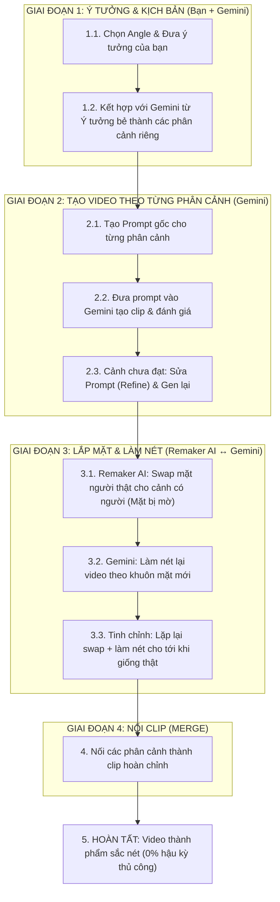

# Quy Trình Sản Xuất Video Bằng AI 100% (Zero-Manual)

Quy trình chuẩn hóa toàn bộ các giai đoạn sản xuất video sản phẩm có người thật, vận hành tự động 100% bằng AI, không qua hậu kỳ hay chỉnh sửa thủ công (chỉ có duy nhất thao tác nối file nếu video dài).

## 1. Sơ Đồ Quy Trình Tổng Thể

***

## 2. Các Step Thực Hiện Chi Tiết

### Giai Đoạn 1: Lên Ý Tưởng & Kịch Bản Phân Cảnh (Kết Hợp Ý Tưởng Của Bạn + Gemini)

* **Step 1.1: Chọn Angle & Đưa Ý Tưởng Của Bạn (Phân 2 Nhóm Content Rõ Rệt)** Bạn đưa ý tưởng, nỗi đau khách hàng hoặc insight sản phẩm của mình vào, định hình theo 2 nhóm Angle chính:
  * **Nhóm A: Basic General (Nội dung kinh điển, bền vững, không lỗi thời, chạy quanh năm):**
    * *Content 1:* **Góc Review giải quyết nỗi sợ** (Problem-Solving / Cho da nhạy cảm / Lão hóa nhăn nheo).
    * *Content 2:* **Góc Trải nghiệm Giác quan** (Sensory / ASMR / Căng bóng Glass Skin).
    * *Content 3:* **Góc Cảnh báo / Giáo dục Skincare** (Educational / Cơ chế khoa học cho độ tuổi 25+).
  * **Nhóm B: Trending / Short-term (Nội dung xu hướng ngắn hạn, thời vụ, kéo tương tác viral):**
    * *Content 4:* **Góc Trend Hài hước** (Gen Z Banter / "Hello các con vợ").
    * *Content 5:* **Góc Vlog Đời sống** (Night Routine cùng mình dưỡng da đi ngủ).
    * *Content 6:* **Góc Tương tác Trend TikTok** (POV / Biến hình trước - sau / Đố bạn biết).
* **Step 1.2: Bẻ Kịch Bản Thành Từng Phân Cảnh Riêng Biệt (Scene Breakdown)** Từ ý tưởng bạn đưa vào, Gemini sắp xếp logic và bẻ thành từng phân cảnh độc lập (4s - 8s/cảnh). Phân định rõ **cảnh nào có mặt người** (để sau này qua Remaker AI) và **cảnh nào là B-roll đồ họa** (không có mặt người, không tốn credit).

***

#### VÍ DỤ PHÂN CẢNH THỰC TẾ CHI TIẾT

*Chủ đề: Đánh thẳng nỗi đau da lão hóa & giải thích cơ chế khoa học 3D tái tạo collagen.*

* **Scene 1 (0s - 4s) \[Hook Nỗi Đau - CÓ MẶT NGƯỜI]:**
  * *Brief:* Đánh thẳng vào nỗi sợ da lão hóa, khô sạm, nhăn nheo để giữ chân người xem ngay 3 giây đầu.
  * *Voiceover:* *"Da lúc nào cũng thô ráp, thâm sạm, nếp nhăn li ti xuất hiện ngày càng rõ?"*
  * *On-screen Text:* **DA THÔ RÁP, NẾP NHĂN LI TI?**
* **Scene 2 (4s - 10s) \[Cơ Chế Khoa Học 3D - B-ROLL KHÔNG CÓ MẶT]:**
  * *Brief:* Cảnh 3D biểu bì da bị khô cằn, đứt gãy collagen để giải thích nguyên nhân gốc rễ (thiếu ẩm, suy yếu từ bên trong).
  * *Voiceover:* *"Đó là khi da vừa thiếu ẩm sâu, vừa suy yếu và đứt gãy collagen từ bên trong."*
  * *On-screen Text:* **THIẾU ẨM & ĐỨT GÃY COLLAGEN**
* **Scene 3 (10s - 16s) \[Trải Nghiệm Dùng Sản Phẩm - CÓ MẶT NGƯỜI]:**
  * *Brief:* Cảnh người phụ nữ da trắng sáng mịn màng thoa kem dưỡng ẩm lên má, mỉm cười thư giãn hài lòng.
  * *Voiceover:* *"Chỉ một bước phục hồi mỗi tối, làn da được đánh thức và cấp ẩm tức thì."*
  * *On-screen Text:* **CẤP ẨM & PHỤC HỒI TỨC THÌ**
* **Scene 4 (16s - 24s) \[Mô Phỏng Sinh Học 3D & Kêu Gọi CTA - ĐỒ HỌA 3D]:**
  * *Brief:* Đồ họa 3D y khoa vi mô dưỡng chất thấm sâu: tế bào teo tóp ngậm nước phồng căng, bó sợi collagen tái liên kết đan chặt, tạo màng khóa ẩm ngăn mất nước TEWL + kêu gọi mua hàng.
  * *Voiceover:* *"Cơ chế thẩm thấu sâu kích hoạt collagen, đánh thức tế bào teo tóp phồng căng và khóa ẩm ngăn mất nước TEWL. Lấy lại làn da căng bóng chuẩn Glass skin ngay tại giỏ hàng góc trái nhé!"*
  * *On-screen Text:* **TÁI TẠO COLLAGEN & KHÓA ẨM TEWL**

***

### Giai Đoạn 2: Tạo Video Cho Từng Phân Cảnh (Bằng Gemini)

* **Step 2.1: Tạo Prompt Gốc Cho Từng Phân Cảnh**
  * Không dùng 1 prompt cho cả video, mà **mỗi phân cảnh ở Step 1.2 sẽ có 1 prompt riêng biệt**.
  * Gemini chuyển đổi mô tả hành động, góc máy và ánh sáng của phân cảnh đó thành prompt tiếng Anh chuẩn cho công cụ sinh video.

> \[!💡]
>
> **PROMPT VIDEO CHUẨN CẦN NÓI RÕ 6 YẾU TỐ SAU:**
>
> 1. **Chủ thể & Ngoại hình:** Ai? (Nữ châu Á 25 tuổi, da có khuyết điểm hoặc căng bóng, trang phục).
> 2. **Hành động & Biểu cảm:** Làm gì? (Cầm lọ kem, thoa nhẹ lên má, cười mỉm - *cử động chậm rãi, không quay đầu giật cục*).
> 3. **Góc máy & Cỡ cảnh:** Quay thế nào? (Cận cảnh Close-up, góc chính diện hoặc nghiêng nhẹ 3/4 để Face Swap chuẩn).
> 4. **Chuyển động Camera:** Máy quay đi đâu? (Đẩy tới từ từ `slow push-in`, lia nhẹ `slow pan`, tránh rung lắc).
> 5. **Ánh sáng & Tone màu:** Màu sắc thế nào? (Tone ấm dịu `warm cozy`, ánh sáng studio mềm `soft diffused light`).
> 6. **Bối cảnh & Định dạng:** Ở đâu? Tỷ lệ gì? (Phòng tắm tối giản, phòng ngủ hiện đại, chuẩn dọc `--ar 9:16`, 4k).

* **Step 2.2: Sinh Video & Đánh Giá Từng Phân Cảnh** Đưa prompt vào Gemini để tạo clip.
* **Step 2.3: Sửa Prompt Phân Cảnh (Prompt Refinement) Nếu Chưa Hài Lòng** Nếu phân cảnh nào chưa đạt (ví dụ: góc máy quay quá gần, cử động tay chưa tự nhiên, biểu cảm nhân vật chưa khớp):
  * Đưa yêu cầu cho Gemini điều chỉnh lại riêng prompt của phân cảnh đó.
  * Sinh lại clip cho phân cảnh đó cho đến khi đạt chất lượng mong muốn.

***

### Giai Đoạn 3: Lắp Mặt Người Thật & Vòng Lặp Làm Nét (Remaker AI ↔ Gemini)

* **Lý do cốt lõi & Vấn đề thực tế:**
  * **Tại sao không làm hết trên Gemini?** Gemini có chính sách kiểm duyệt rất gắt gao và **chặn hoàn toàn tính năng thay/ghép mặt người thật do vi phạm Policy chống Deepfake & quyền danh tính**. Do đó, bắt buộc phải dùng một bên thứ ba chuyên biệt là **Remaker AI** để thực hiện việc hoán đổi mặt.
  * **Vấn đề của bên thứ ba:** Remaker AI thay được mặt người thật nhưng lại làm khuôn mặt **rất mờ (bị giảm độ nét/low-res)**.
  * **Giải pháp phối hợp 2 công cụ:** Tận dụng Remaker AI để "vượt rào" khâu ghép mặt, sau đó đưa video quay ngược lại **Gemini để làm nét (Enhance/Upscale)** theo diện mạo mới. Nếu cảm giác mặt vẫn chưa đủ giống, tiếp tục lặp lại chu trình này nhiều lần cho đến khi đạt chuẩn.
* **Chu trình thực hiện thực tế (Chỉ áp dụng cho các phân cảnh có mặt người):**
  * **Vòng 1 (Lắp mặt thô & Làm nét):**
    1. Upload file video của phân cảnh có người + ảnh mặt người thật lên **Remaker AI** để swap mặt $\rightarrow$ Khuôn mặt được thay nhưng bị mờ.
    2. Đưa video vừa swap này vào **Gemini** để làm nét lại toàn bộ video theo khuôn mặt mới.
  * **Vòng 2 (Tinh chỉnh tăng độ giống & Độ nét - lặp lại nhiều lần nếu cần):**
    1. Lấy video vừa được Gemini làm nét $\rightarrow$ đưa lại vào **Remaker AI** để swap mặt tiếp giúp khuôn mặt mới khớp sâu và giống người thật hơn.
    2. Tiếp tục đưa video này qua **Gemini** làm nét lại lần nữa.
* **Kết quả Giai đoạn 3:** Các phân cảnh có người đã được thay mặt hoàn thiện, sắc nét và tự nhiên.

***

### Giai Đoạn 4: Nối Clip (Merge Các Phân Cảnh Thành Video Hoàn Chỉnh)

* **Thực hiện:**
  * Tập hợp tất cả các file video phân cảnh đã hoàn thiện: **Các cảnh người đã swap mặt & làm nét ở GĐ 3** + **Các cảnh sản phẩm/3D ở GĐ 2**.
  * Dùng công cụ nối video tự động (tool online hoặc script nối file `.mp4`) để ghép nối tiếp các file lại theo đúng thứ tự kịch bản (Scene 1 $\rightarrow$ Scene 2 $\rightarrow$ Scene 3 $\rightarrow$ Scene 4...).
  * **Không can thiệp thủ công:** Không cắt dựng timeline, không kéo thả hiệu ứng chuyển cảnh, chỉ thuần túy nối file.
  * 👉 **Kết quả:** Nhận video hoàn chỉnh bằng AI mà không qua hậu kỳ thủ công.

***

## 3. Công Cụ, Giới Hạn & Bảng Giá (Pricing & Limits)

### 1. Gemini / Google AI (Bảng Giá & Hạn Mức)

* **Nhiệm vụ:** Tiếp nhận ý tưởng cùng bạn bẻ kịch bản $\rightarrow$ Viết prompt từng cảnh $\rightarrow$ Sinh video $\rightarrow$ **Làm nét lại video (Enhance/Upscale)** sau mỗi lần Remaker AI swap mặt.
* **Bảng chi tiết các gói Google AI tại Việt Nam (Tính đúng số giây video tạo được / phiên 5h theo tỷ lệ):**

| Gói dịch vụ                               | Giá tiền (VND/tháng)     | Hệ số hạn mức (Google công bố) | Hạn mức Video (Số giây tạo được / phiên 5h) |
| ----------------------------------------- | ------------------------ | ------------------------------ | ------------------------------------------- |
| **Google AI Plus**                        | **132.000đ**             | **1/2 gói Pro**                | **25 giây video**                           |
| **Google AI Pro** *(Gói chuẩn đang dùng)* | **489.000đ** (\~\$19.99) | Mốc chuẩn hiện tại             | **50 giây video**                           |
| **Google AI Ultra (Mức 1)**               | **2.250.000đ**           | **5x** gói Pro                 | **250 giây video** (4 phút 10 giây)         |
| **Google AI Ultra (Mức 2)**               | **5.500.000đ**           | **20x** gói Pro                | **1.000 giây video** (16 phút 40 giây)      |

***

### 2. Remaker AI (Face Swap Video)

* **Nhiệm vụ:** Tự động hoán đổi mặt nhân vật trong video sang mặt người thật.
* **Hình thức thanh toán:** Nạp credit dùng dần (One-time payment, VIP vĩnh viễn, không trừ phí duy trì hàng tháng).
* **Nguyên tắc tính Credit theo số giây CÓ MẶT NGƯỜI thực tế:**
  * **Chỉ tính phí trên số giây có khuôn mặt người cần xử lý:** Video không có người (cận cảnh sản phẩm, đồ họa 3D mô phỏng) thì hoàn toàn **không tốn credit**.
  * *Ví dụ thực tế:* Một clip dài 30s nhưng người chỉ xuất hiện 10s (20s còn lại là cận cảnh sản phẩm), thì 1 vòng swap **chỉ tốn đúng 10 credits**.
  * Nếu chạy 2 vòng swap (để tăng độ nét & giống thật), 10s có mặt người đó sẽ tốn: $10\text{s} \times 2 = \mathbf{20\text{ Credits}}$.

> \[!💡]
>
> **LƯU Ý THAO TÁC CỦA USER (KHUYÊN DÙNG):**
>
> * Remaker AI tính tiền dựa trên **tổng thời lượng của file tải lên**, hệ thống **KHÔNG** tự động nhận diện để cắt lọc đoạn có người.
> * Để tiết kiệm Credit, người dùng chỉ nên upload riêng file phân cảnh có người. Không nên upload cả file gộp 30s lên swap vì sẽ bị trừ không cần thiết.

* **Bảng chi tiết các gói nạp:**

| Gói Credit         | Giá niêm yết (USD) | Đơn giá / 1 Credit | Mức giảm                       | Số giây video có mặt người xử lý được (1s = 1 credit) |
| ------------------ | ------------------ | ------------------ | ------------------------------ | ----------------------------------------------------- |
| **200 Credits**    | \$5.99             | \~\$0.0300         | Gốc                            | 200 giây có mặt người                                 |
| **530 Credits**    | **\$9.99**         | **\~\$0.0188**     | **Giảm 38% (Gói tối ưu nhất)** | **530 giây có mặt người**                             |
| **1,100 Credits**  | \$19.99            | \~\$0.0181         | Giảm 40%                       | 1.100 giây có mặt người                               |
| **3,000 Credits**  | \$49.99            | \~\$0.0166         | Giảm 45%                       | 3.000 giây có mặt người                               |
| **20,000 Credits** | \$299.00           | \~\$0.0149         | Giảm 50%                       | 20.000 giây có mặt người                              |

***

## 4. Bảng Tính Chi Phí Thực Tế (Ví Dụ Clip 30s: 10s Mặt Người + 20s Cận Cảnh Sản Phẩm)

*Quy chuẩn thực tế: 1 clip hoàn chỉnh dài&#x20;****30 giây****&#x20;(trong đó chỉ có&#x20;****10s có mặt người****&#x20;cần swap 2 vòng, còn&#x20;****20s là B-roll sản phẩm/3D****&#x20;không tốn credit):*

| Hạng mục                         | Mức tiêu thụ thực tế                                                | Chi phí ước tính                                         | Quy đổi VNĐ (\~25.500đ/\$) |
| -------------------------------- | ------------------------------------------------------------------- | -------------------------------------------------------- | -------------------------- |
| **Gemini AI Video & Làm Nét**    | Gen video các cảnh (tính cả buffer làm lại) + 2 lượt làm nét        | Khấu hao gói \$19.99/tháng (ước tính \~40-50 clip/tháng) | \~9.800 VNĐ                |
| **Remaker AI Swap**              | **Chỉ tính 10s có mặt người** $\times$ 2 vòng swap = **20 Credits** | 20 × $0.0188= $0.38 (Gói \$9.99)                         | **\~9.600 VNĐ**            |
| **20s B-roll Cận cảnh sản phẩm** | Không có người xuất hiện                                            | 0 Credit                                                 | 0 VNĐ                      |
| **Thao tác Merge**               | Nối tự động các file video                                          | 0 VNĐ                                                    | 0 VNĐ                      |
| **Hậu kỳ thủ công**              | Hoàn toàn không có (0%)                                             | 0 VNĐ                                                    | 0 VNĐ                      |
| **TỔNG CHI PHÍ THỰC TẾ/ CLIP**   | **30 giây hoàn chỉnh (10s người thật + 20s sản phẩm)**              | **\~\$0.87**                                             | **\~19.400 VNĐ / clip**    |

***

## 5. Bảng Tổng Kết Phân Định Trách Nhiệm: Người (User) vs. Platform (AI & Công Cụ)

| Giai đoạn sản xuất            | Thao tác cụ thể                             | Vai trò của Người (User)                                                                                                                                             | Platform / Công cụ AI đảm nhiệm                                                                                                              | Đánh giá mức độ tự động                       |
| ----------------------------- | ------------------------------------------- | -------------------------------------------------------------------------------------------------------------------------------------------------------------------- | -------------------------------------------------------------------------------------------------------------------------------------------- | --------------------------------------------- |
| **GĐ 1: Ý Tưởng & Kịch Bản**  | **1.1. Chọn Angle & Nêu ý tưởng**           | **100% Người làm:** Đưa insight sản phẩm, nỗi đau khách hàng, lựa chọn concept (Basic hay Trending).                                                                 | Không tham gia (hoặc gợi ý ý tưởng khi người dùng yêu cầu).                                                                                  | Thủ công (Đầu vào định hướng)                 |
|                               | **1.2. Bẻ kịch bản phân cảnh**              | **Cùng làm trực tiếp (\~40-50%):** Định hình sườn phân cảnh, chỉnh sửa câu thoại/hành động, phân định dứt khoát cảnh nào có người và cảnh nào là B-roll sản phẩm/3D. | **Gemini hỗ trợ gợi ý (\~50-60%):** Đề xuất cấu trúc phân cảnh logic (4s - 8s/cảnh), phân bổ thời lượng và diễn giải chi tiết hành động.     | **Bán tự động** (AI \~50-60%, Người \~40-50%) |
| **GĐ 2: Tạo Video Từng Cảnh** | **2.1. Viết Prompt video**                  | **Ra lệnh:** Yêu cầu Gemini tạo prompt theo từng phân cảnh đã chốt.                                                                                                  | **Gemini tự động hóa:** Chuyển đổi kịch bản thành Prompt tiếng Anh chuẩn điện ảnh (6 yếu tố góc quay, chuyển động, ánh sáng...).             | Tự động hóa 90%                               |
|                               | **2.2. Sinh clip & Đánh giá**               | **Đánh giá thẩm mỹ:** Xem clip và quyết định đạt hay cần sửa (Refine prompt).                                                                                        | **Gemini Video tự động sinh:** Xử lý và render thành file video .mp4 từ prompt.                                                              | Tự động hóa 90% (Người quyết định)            |
| **GĐ 3: Lắp Mặt & Làm Nét**   | **3.1. Phân loại file trước khi swap**      | **100% Người làm (Bắt buộc):** Chủ động lọc riêng các file clip có mặt người để upload lên Remaker AI (tiết kiệm credit).                                            | Hệ thống **không** tự động cắt lọc phân cảnh từ video gộp.                                                                                   | Thủ công (Kiểm soát chi phí)                  |
|                               | **3.2. Chu trình Swap mặt & Làm nét**       | **Chuyển giao file:** Upload ảnh/video và tải file kết quả luân chuyển giữa 2 nền tảng (Vòng 1 & Vòng 2).                                                            | **Remaker AI + Gemini tự động:**&#xA;• Remaker AI: Tự động hoán đổi mặt người thật.&#xA;• Gemini: Tự động upscale làm nét lại toàn bộ video. | Tự động hóa 85%                               |
| **GĐ 4: Nối Clip (Merge)**    | **Nối các phân cảnh thành clip hoàn chỉnh** | **Thao tác đơn giản:** Thả các file video hoàn thiện vào công cụ nối (hoặc chạy 1 dòng lệnh script).                                                                 | **Tool Merge / Script tự động:** Nối tiếp các file .mp4 theo thứ tự kịch bản thành 1 video dài hoàn chỉnh.                                   | Tự động hóa 95%                               |
